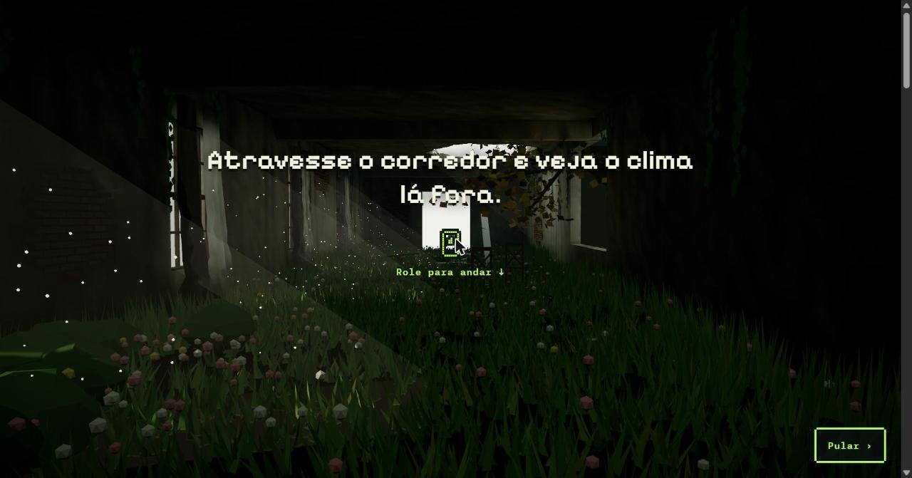
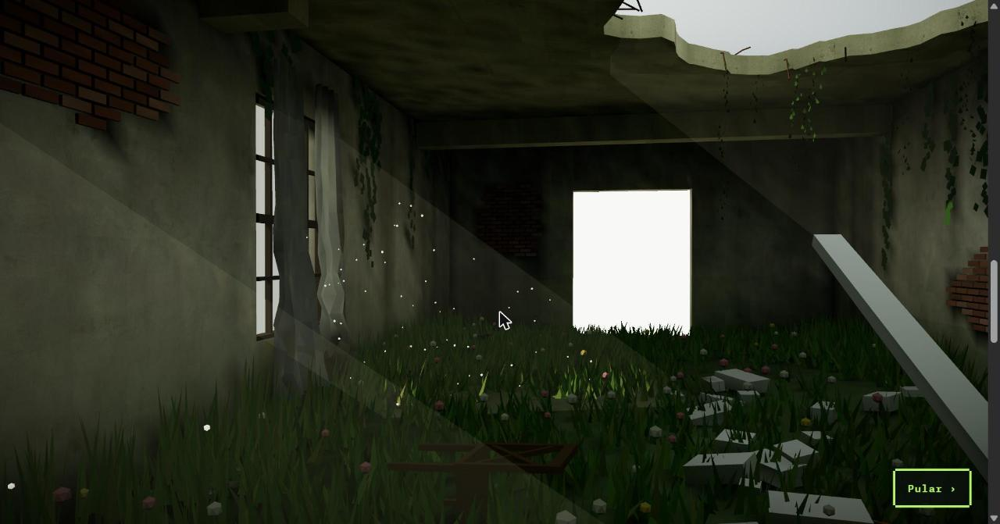
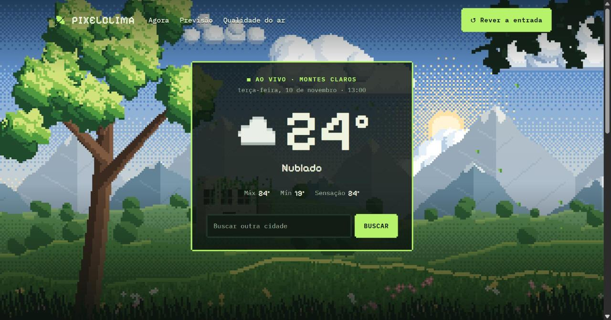
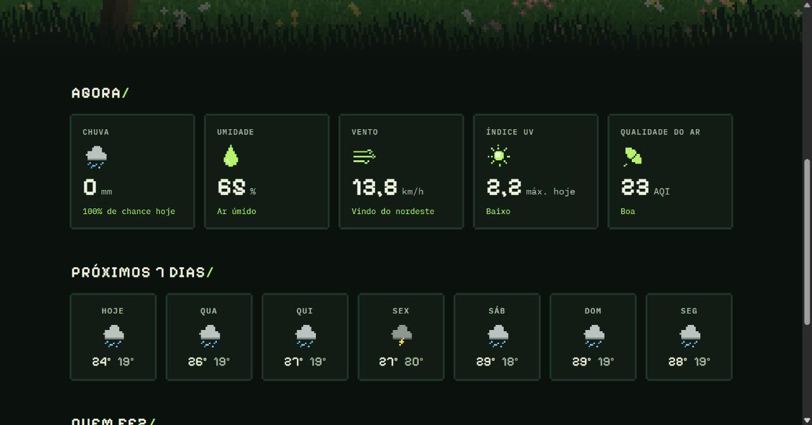

<h1 align="center">PixelClima</h1>

<p align="center">
  O clima real da sua cidade em pixel art, depois de atravessar um corredor abandonado em 3D.
</p>

<p align="center">
  <a href="https://pixelclima.vercel.app/"><strong>▶ Acessar o site</strong></a>
</p>

<p align="center">
  
  
  
  
  
  
  
</p>

<p align="center">
  
</p>

## Sobre o projeto

O PixelClima tem duas partes. Na entrada, você rola a página e a câmera atravessa um prédio abandonado tomado pela natureza, modelado no Blender e renderizado em tempo real no navegador. Ao chegar na porta iluminada no fim do corredor, você sai para o site de clima, todo em pixel art.

O site mostra o tempo da sua cidade agora, a previsão dos próximos 7 dias e a qualidade do ar, com dados da [Open-Meteo](https://open-meteo.com/).

<p align="center">
  
</p>

## Funcionalidades

### Entrada em 3D

- Câmera controlada pelo scroll, seguindo o caminho animado no Blender.
- Grama e folhas balançando com o vento, partículas de luz e pós-processamento com bloom, vinheta e granulado.
- Tela de carregamento com porcentagem e botão **Pular** para ir direto ao clima.
- O código do 3D só é baixado quando o corredor aparece, para o site abrir mais rápido.
- Qualidade ajustada automaticamente em celulares e aparelhos mais fracos.
- Quem ativou "reduzir movimento" no sistema vai direto para o clima.
- Botão **Rever a entrada** para atravessar o corredor de novo.

### Clima

- Localização automática pelo navegador, com Montes Claros como cidade padrão.
- Busca de outras cidades, e a última escolhida fica salva.
- Temperatura atual, máxima, mínima, sensação térmica e condição do tempo.
- Chuva, umidade, vento, índice UV e qualidade do ar.
- Previsão dos próximos 7 dias.
- Fundo que muda conforme o tempo: sol, chuva, neve ou noite.
- Atualização automática a cada 15 minutos.

<p align="center">
  
</p>

<p align="center">
  
</p>

## Tecnologias

| Área | Ferramentas |
| --- | --- |
| Interface | React 19, TypeScript e CSS |
| 3D | Three.js, React Three Fiber, Drei e React Postprocessing |
| Modelagem | Blender, com a cena exportada em `.glb` |
| Dados | APIs da Open-Meteo (previsão, busca de cidades e qualidade do ar) |
| Build e testes | Vite, Vitest e ESLint |
| Publicação | Vercel |

## Como rodar localmente

É preciso ter o [Node.js](https://nodejs.org/) instalado. A Open-Meteo é gratuita e não pede chave de API.

```bash
git clone https://github.com/Matheusmpodev/projeto3D.git
cd projeto3D
npm install
npm run dev
```

Outros comandos:

```bash
npm run build    # gera a versão de produção
npm run preview  # abre a versão de produção localmente
npm test         # roda os testes
npm run lint     # confere o código
```

## Estrutura do projeto

O código é organizado por funcionalidade:

```
src/
├── App.tsx              # Alterna entre o corredor e o site
└── features/
    ├── corredor/        # Entrada em 3D
    │   ├── assets/      # Cena exportada do Blender (cena.glb)
    │   ├── components/  # Câmera, cenário, iluminação, pós-processamento e telas da abertura
    │   ├── hooks/       # Progresso do scroll e carregamento da cena
    │   └── lib/         # Vento, ambiente e ajustes por dispositivo
    └── clima/           # Site de clima
        ├── components/  # Card ao vivo, seções, busca, menu e rodapé
        ├── hooks/       # useClima: estado e atualização dos dados
        ├── services/    # Chamadas à Open-Meteo e localização
        └── lib/         # Formatação, imagens e contatos
```

## Autor

Feito por **Matheus Pereira de Oliveira**, estudante de Análise e Desenvolvimento de Sistemas no IFNMG.

[LinkedIn](https://www.linkedin.com/in/matheus-pereira-28b312350) · [GitHub](https://github.com/Matheusmpodev)

## Licença

Este projeto está sob a licença MIT. Veja o arquivo [LICENSE](LICENSE) para mais detalhes.
